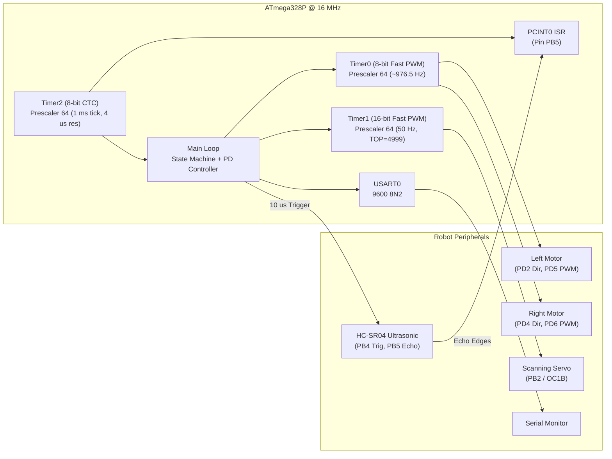
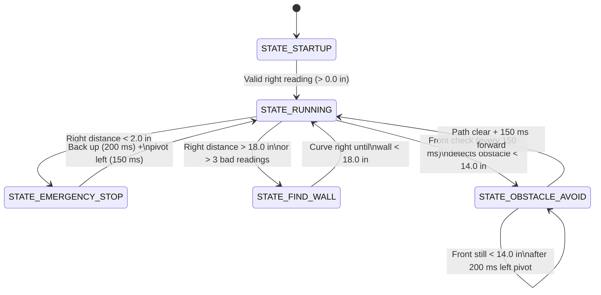

# Wall-Following Robot (ATmega328P)

AVR C firmware for an autonomous differential-drive robot that tracks a right-hand wall using a servo-mounted HC-SR04 ultrasonic sensor and a Proportional-Derivative (PD) motor controller. Built for **COE185 Lab Project 3**.

---

## System Architecture

The firmware splits hardware timers and interrupts across three dedicated peripherals so that distance timing, servo pulse generation, and wheel PWM never block or interfere with each other:



---

## Navigation State Machine

During normal operation (`STATE_RUNNING`), the servo stays pointed to the right (`SERVO_RIGHT = 150`, ~600 us pulse) to sample the wall continuously. Every `150 ms`, the robot briefly slows to `MIN_SPEED`, sweeps the servo forward (`SERVO_FRONT = 350`, ~1400 us pulse) to check for front obstacles, and returns the servo to the right wall.



---

## Hardware Pinout & Timer Allocation

```text
                        ATmega328P (Arduino Uno Mapping)
                             +------------------+
                        PC6 -| 1             28 |- PC5
        UART RX (D0) <- PD0 -| 2             27 |- PC4
        UART TX (D1) -> PD1 -| 3             26 |- PC3
       LEFT_DIR (D2) <- PD2 -| 4             25 |- PC2
                        PD3 -| 5             24 |- PC1
      RIGHT_DIR (D4) <- PD4 -| 6             23 |- PC0
                        VCC -| 7             22 |- GND
                        GND -| 8             21 |- AREF
                        PB6 -| 9             20 |- AVCC
                        PB7 -| 10            19 |- PB5 -> ECHO_PIN (D13 / PCINT5)
       LEFT_PWM (D5) <- PD5 -| 11 (OC0B)     18 |- PB4 <- TRIGGER_PIN (D12)
      RIGHT_PWM (D6) <- PD6 -| 12 (OC0A)     17 |- PB3
                        PD7 -| 13            16 |- PB2 -> SERVO_PIN (D10 / OC1B)
                        PB0 -| 14            15 |- PB1
                             +------------------+
```

| Peripheral | AVR Pin | Arduino Pin | Direction | Hardware Resource | Notes |
| :--- | :--- | :--- | :--- | :--- | :--- |
| **Left Motor Dir** | `PD2` | `D2` | Output | GPIO (`PORTD`) | `HIGH` = Forward, `LOW` = Backward |
| **Right Motor Dir** | `PD4` | `D4` | Output | GPIO (`PORTD`) | `LOW` = Forward, `HIGH` = Backward |
| **Left Motor PWM** | `PD5` | `D5` | Output | `Timer0` (`OC0B`) | Fast PWM, scaled by `MOTOR_TOP_SPEED` (200) |
| **Right Motor PWM** | `PD6` | `D6` | Output | `Timer0` (`OC0A`) | Fast PWM, scaled by `MOTOR_TOP_SPEED` (200) |
| **Servo Signal** | `PB2` | `D10` | Output | `Timer1` (`OC1B`) | 50 Hz Fast PWM (`OCR1A = 4999`, 4 us/tick) |
| **Ultrasonic Trig** | `PB4` | `D12` | Output | GPIO (`PORTB`) | 10 us HIGH pulse initiates measurement |
| **Ultrasonic Echo** | `PB5` | `D13` | Input | `PCINT0` (`PCINT5`) | Rising/falling edges timed with `micros()` |
| **System Timebase** | Internal | Internal | Internal | `Timer2` (`COMPA`) | CTC mode (`OCR2A = 249`), 1 ms ISR, 4 us `TCNT2` |

---

## Repository Structure

```text
COE185--LAB_PROJECT--WALL_FOLLOWING_ROBOT/
├── src/
│   ├── main.c          # 5-state navigation FSM, moving-average filter, and PD controller
│   ├── motors.c        # Timer0 Fast PWM setup and differential wheel control
│   ├── servo.c         # Timer1 50 Hz servo control and position tracking
│   ├── ultrasonic.c    # PCINT0 non-blocking echo capture and inch conversion
│   ├── time.c          # Timer2 CTC 1 ms / 4 us timebase (millis / micros)
│   └── uart.c          # 9600-baud serial telemetry helpers
├── include/
│   ├── motors.h        # Motor pins, direction constants, and MOTOR_TOP_SPEED
│   ├── servo.h         # Servo pin and pulse-width tick constants
│   ├── ultrasonic.h    # Ultrasonic trigger/echo pins and measurement API
│   ├── time.h          # Timekeeping function declarations
│   └── uart.h          # UART initialization and print declarations
├── docs/
│   ├── GUIDE.md        # Hardware setup, timer math, PD tuning, and troubleshooting
│   └── ABOUT.md        # Project overview and authorship notes
├── Makefile            # Build, size, and avrdude flash rules
└── README.md           # Architecture, pinout, and quick-start documentation
```

---

## Build & Flash

### Prerequisites
- `avr-gcc` and `avr-libc`
- `avrdude`
- GNU `make`

### 1. Compile the Firmware
```powershell
make clean
make
```
This compiles all modules in `src/` with headers from `include/` and generates `main.elf` and `main.hex`.

### 2. Flash to ATmega328P
Update `PROGRAMMER` in [`Makefile`](Makefile) if your board uses a port other than `COM3`:
```makefile
PROGRAMMER = -c arduino -b 115200 -P COM3
```
Then flash over USB:
```powershell
make flash
```

---

## Control & Tuning Summary

All distances are processed in **inches**. Key parameters in [`src/main.c`](src/main.c) and [`include/motors.h`](include/motors.h):

| Parameter | Default | Description |
| :--- | :--- | :--- |
| `DESIRED_DISTANCE_IN` | `9.0 in` | Target distance maintained from the right wall. |
| `DISTANCE_TOLERANCE` | `2.5 in` | Error band within which the robot accelerates to `MAX_SPEED` (`0.32`). |
| `OBSTACLE_TH_IN` | `14.0 in` | Front distance threshold that triggers `STATE_OBSTACLE_AVOID`. |
| `WALL_LOST_TH_IN` | `18.0 in` | Right distance threshold that triggers `STATE_FIND_WALL`. |
| `EMERGENCY_STOP_DIST` | `2.0 in` | Minimum right-wall clearance before backing up (`STATE_EMERGENCY_STOP`). |
| `KP` / `KD` | `0.035` / `0.015` | Proportional and derivative gains for differential wheel steering. |
| `MOTOR_TOP_SPEED` | `200` | Maximum 8-bit Timer0 PWM ceiling (out of 255). |

For detailed calibration steps, PD controller math, and troubleshooting, see [`docs/GUIDE.md`](docs/GUIDE.md).
